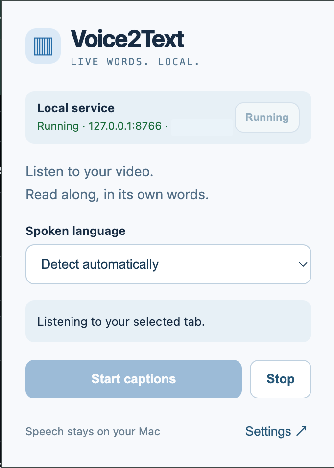
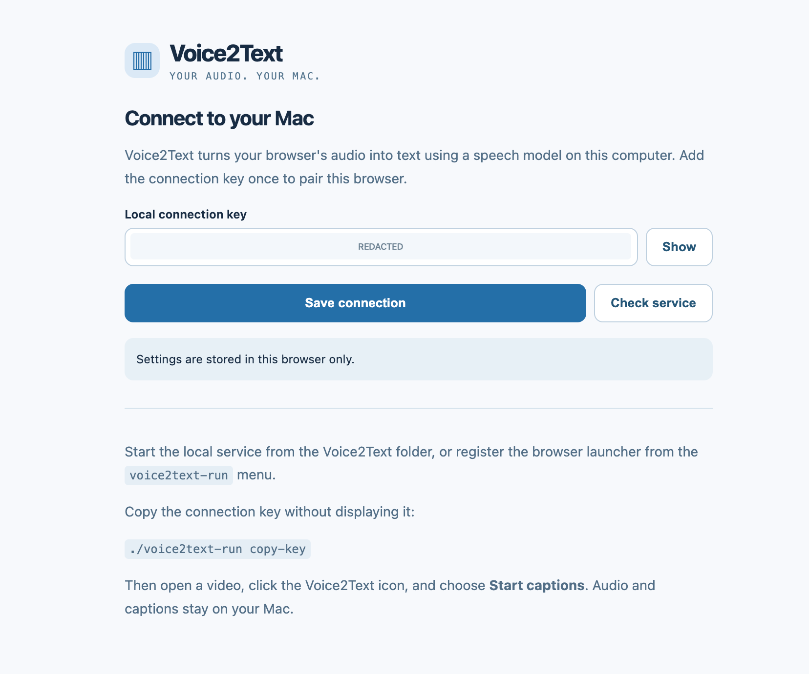
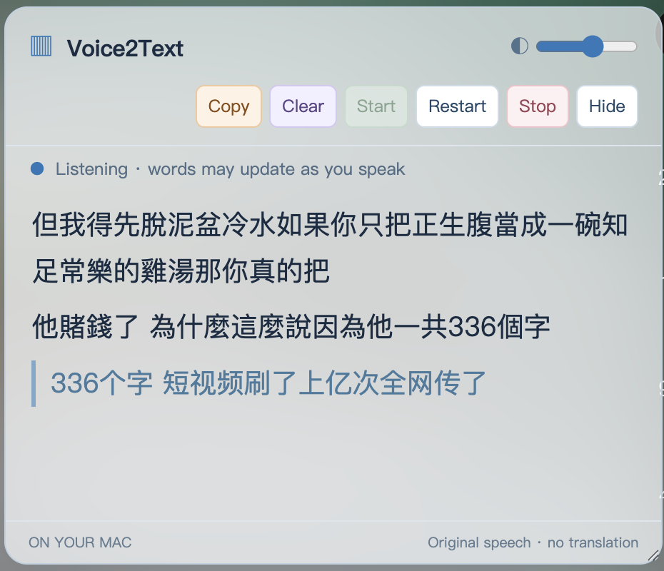

# Voice2Text

适配 Chrome / Brave 的独立浏览器插件，将当前标签页播放的声音交给本机语音识别服务，持续显示原文字幕与可复制文字。

## Screenshots

  
  

  

## 当前状态

Voice2Text 的扩展和本地识别服务已实现。扩展弹窗包含后台状态、端口/PID 和本地启动按钮。Native Messaging 安装及跨浏览器验收仍需在目标 Mac 上完成；长时间稳定性也未作保证。

## 已确认范围

- 产品名称：`Voice2Text`。
- 项目根目录：克隆或解压后所在的 `Voice2Text/` 目录。
- Chrome / Brave 共用 Manifest V3 扩展。
- 第一版目标环境：Apple Silicon Mac、macOS、Chrome 或 Brave；使用 Python 3.12 项目虚拟环境和本地 MLX Whisper 模型。
- 本机服务可由 `voice2text-run` 管理；可选 Native Messaging host 允许扩展弹窗启动本地服务。安装后需在各浏览器注册扩展 ID。
- 本机语音识别、临时字幕更新、稳定文字定稿、可选择复制的文字区。
- 翻译由其他软件处理，第一版没有翻译功能或大模型中台依赖。

## 下载

可直接下载包含本地服务、浏览器扩展和安装说明的 [Voice2Text ZIP](dist/Voice2Text.zip)。

## 项目文档

- [安装与使用](docs/usage.md)

## 交付标准

项目提供扩展、本地识别服务、安装与启停入口。服务端真实模型识别及 Chrome 实际采音转写均已验证；后台启动桥接尚待 Chrome / Brave 实机注册验收，跨视频连续性和长时间运行也尚未完成。
